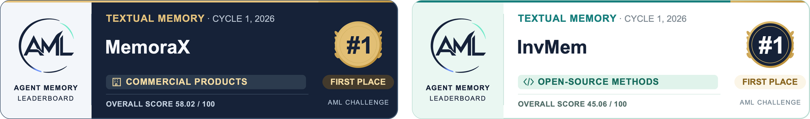
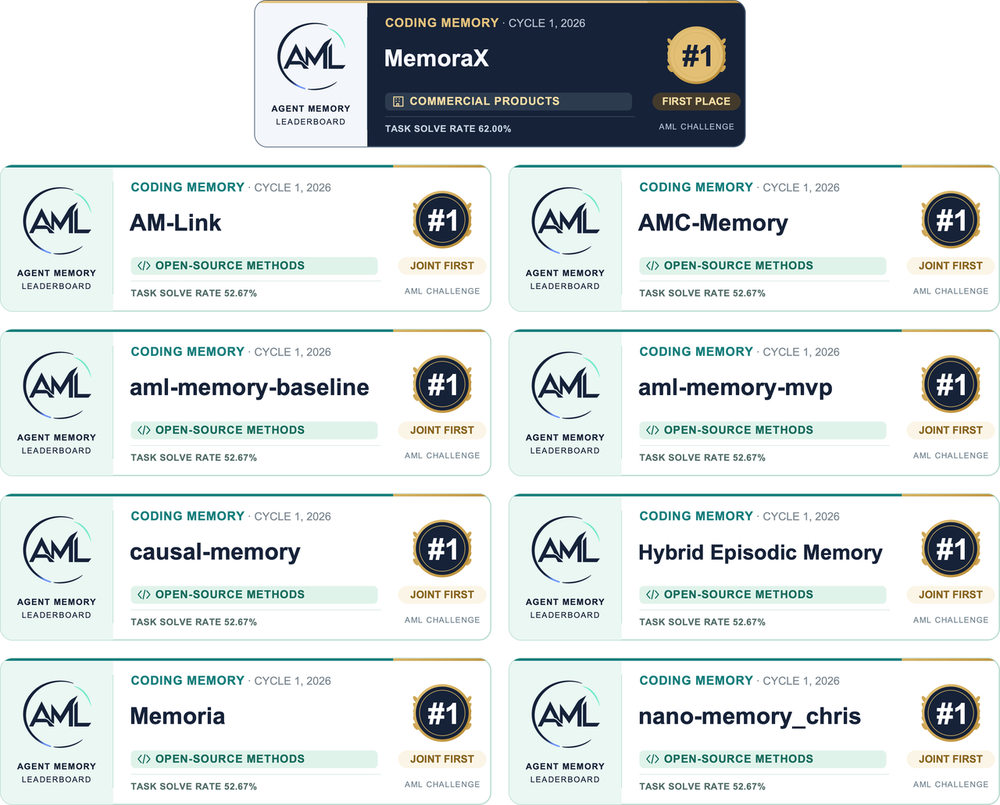

<div align="center">

# 🧠 Agent Memory Leaderboard

**Open, standardized, and reproducible evaluation for long-term memory systems**

[Public Leaderboards](https://agentmemoryleaderboard.ai/leaderboard/industry/textual) | [2026 Memory Challenge](https://agentmemoryleaderboard.ai/competition/) | [Evaluation Status](https://agentmemoryleaderboard.ai/evaluation) | [Documentation](https://agentmemoryleaderboard.ai/docs) | [API Guide](https://agentmemoryleaderboard.ai/api-guide)

**English** | [简体中文](README_CN.md)

</div>

Agent Memory Leaderboard (AML) is a public evaluation platform for long-term agent memory systems. It provides a unified evaluation protocol and public leaderboards for Textual, Coding, and Multimodal Memory. Participating systems provide **Add** for memory ingestion and **Search** for retrieval; AML handles answer generation or agent execution, scoring, result review, and leaderboard publication. Founded by researchers from more than twenty universities and research organizations, AML supports verifiable comparisons of open-source methods and commercial products within the same track and evaluation contract.

## 📰 Latest Updates

- **November 4, 2026 — Cycle 2 formal evaluation closes at 23:59 (Beijing time). APIs for submitted systems must remain available. The platform will process queued and ongoing jobs and retries following errors according to official arrangements.**
- **October 31, 2026** — The Cycle 2 submission deadline has passed. The submission portal closed at 02:00 on November 1 (Beijing time), and the challenge has entered the evaluation and review phase.
- **September 20, 2026** — The second Agent Memory Challenge opened for registration and evaluation, with Textual, Coding, and Multimodal Memory tracks.

## 🏆 Second Agent Memory Challenge 2026

**The second Agent Memory Challenge is organized by the China Society of Image and Graphics (CSIG) and co-organized by Nanjing University, Zhejiang University, Datawhale, and the CSIG Committee for Enterprise Liaison and Standardization.** AML provides the unified evaluation platform. Textual, Coding, and Multimodal Memory are evaluated and ranked separately, with Open-source Methods and Commercial Products divisions in each track.

| Milestone | Date / Status |
| --- | --- |
| Registration and evaluation opened | September 20, 2026 · 00:00 |
| Materials submission deadline | October 31, 2026 · 23:59; the portal closed on November 1 at 02:00 |
| Formal evaluation closes | November 4, 2026 · 23:59 |
| **Official leaderboard release** | **Mid-November 2026** |
| Prize pool | US$22,000; Open-source Methods division only |

All times are Beijing time (UTC+8). After formal evaluation closes on November 4, the platform will aim to complete queued and ongoing jobs, along with retries following errors, over approximately the next two days, subject to operating conditions. Participants must keep their APIs stable and available until their jobs finish. Final arrangements are subject to official notices.

[Challenge Details](https://agentmemoryleaderboard.ai/competition/) · [Evaluation Status](https://agentmemoryleaderboard.ai/evaluation) · [Participation Rules](https://agentmemoryleaderboard.ai/rules)

## 🏅 Inaugural Agent Memory Challenge 2026

The inaugural Agent Memory Challenge (AML Cycle 1) launched on July 29, 2026, with its first leaderboards published on August 12, 2026. Key results by division:

- **Open-source Methods:** [**InvMem**](https://github.com/wenxiaof345-ctrl/vanilla-rag-memory) ranked first in Textual Memory. Eight systems, including [**aml-memory-mvp**](https://github.com/0xboyu/aml-memory-mvp), [**causal-memory**](https://github.com/JingxuanC/causal-memory), [**Memoria_v2**](https://github.com/lin-guan/aml-rag-v2), and [**nano-memory_chris**](https://github.com/himalalps/nano-memory), tied for first in Coding Memory.
- **Commercial Products:** [**MemoraX**](https://www.memoraxai.com/) and [**MemOS**](https://memos.openmem.net/) led the inaugural AML rankings, each placing in the top two on both the Textual Memory and Coding Memory leaderboards.

The tables below show the top three ranks in the Open-source Methods and Commercial Products divisions.

### Textual Memory



| Division | 🥇 First | 🥈 Second | 🥉 Third |
| --- | --- | --- | --- |
| Open-source methods | [InvMem](https://github.com/wenxiaof345-ctrl/vanilla-rag-memory) (45.06) | [Refind](https://github.com/imlrz/ReFind) (44.97) | [ActiveMemoryIndex](https://github.com/linxuhao/ActiveMemoryIndex.git) (44.84) |
| Commercial products | [MemoraX v0.5](https://huggingface.co/spaces/agent-memory-leaderboard/leaderboard/blob/d01a32165aef2124b9732bd0fda7f79380b931dc/data/generated/leaderboard_data.json) (58.02) | [MemOS v2.0.1](https://huggingface.co/spaces/agent-memory-leaderboard/leaderboard/blob/d01a32165aef2124b9732bd0fda7f79380b931dc/data/generated/leaderboard_data.json) (45.89) | [NTES-MEMORY-SMART AML-Eval-SMART](https://huggingface.co/spaces/agent-memory-leaderboard/leaderboard/blob/d01a32165aef2124b9732bd0fda7f79380b931dc/data/generated/leaderboard_data.json) (44.21) |

### Coding Memory



| Division | 🥇 First | 🥈 Second | 🥉 Third |
| --- | --- | --- | --- |
| Open-source methods | [AM-Link](https://github.com/Graygoo7529/AM-L) (52.67%)<br>[AMC-Memory](https://github.com/cxy935/AMC-Memo) (52.67%)<br>[aml-memory-baseline](https://github.com/richrichgo/aml-memory-ba) (52.67%)<br>[aml-memory-mvp](https://github.com/0xboyu/aml-memory-mvp) (52.67%)<br>[causal-memory](https://github.com/JingxuanC/causal-memory) (52.67%)<br>[Hybrid Episodic Memory](https://github.com/tlysanhuo/agent-memory-challenge) (52.67%)<br>[Memoria_v2](https://github.com/lin-guan/aml-rag-v2) (52.67%)<br>[nano-memory_chris](https://github.com/himalalps/nano-memory) (52.67%) | — | — |
| Commercial products | [MemoraX v0.5](https://huggingface.co/spaces/agent-memory-leaderboard/leaderboard/blob/d01a32165aef2124b9732bd0fda7f79380b931dc/data/generated/code_leaderboard_data.json) (62.00%) | [claude-mem v12.1.1](https://huggingface.co/spaces/agent-memory-leaderboard/leaderboard/blob/d01a32165aef2124b9732bd0fda7f79380b931dc/data/generated/code_leaderboard_data.json) (52.00%)<br>[hs v3](https://huggingface.co/spaces/agent-memory-leaderboard/leaderboard/blob/d01a32165aef2124b9732bd0fda7f79380b931dc/data/generated/code_leaderboard_data.json) (52.00%)<br>[MemOS v2.0.1](https://huggingface.co/spaces/agent-memory-leaderboard/leaderboard/blob/d01a32165aef2124b9732bd0fda7f79380b931dc/data/generated/code_leaderboard_data.json) (52.00%) | — |

## 🎯 Why AML

Long-term memory systems often use different datasets, answer models, retrieval settings, and scoring methods, making research findings and product results difficult to compare. AML holds data versions, answer generation and scoring pipelines, retrieval limits, and aggregation rules fixed under a common evaluation contract.

- **Broad coverage:** Evaluate long-term memory across extended conversations, multiple sessions, software engineering, and image–text interactions.
- **Controlled comparisons:** Hold downstream evaluation conditions constant to support comparisons under the same contract.
- **Diagnostic insights:** Report overall scores, track-level metrics, and capability profiles to reveal strengths and failure modes.

## 🧩 What AML Evaluates

Cycle 2 covers three independent tracks, each with fixed data, execution procedures, and scoring rules.

| Track | Scope | Scale | Evaluation Contract |
| --- | --- | --- | --- |
| **Textual Memory** | Fact recall, multi-hop relations, temporal events, memory governance, personalization, rule execution, safety, and privacy | 6,000+ evaluation instances; 32 data sources; approximately 300M tokens | `textual-v1` / `ldbd-textual-official-suite-v1` |
| **Coding Memory** | Retrieval, filtering, and reuse of engineering experience from the same repository | 300 evaluation instances; 2 data types; approximately 1.8B tokens | `coding-v1` / `cambench-coding-relevant-noisy-300-v1` |
| **Multimodal Memory** | Image–text memory ingestion, cross-modal retrieval, and evidence use | Nearly 5,000 evaluation instances; 7 data sources; approximately 800M tokens | `multimodal-v2` / `ldbd-multimodal-suite-v2` |

## 📚 How AML Evaluates

Participating systems provide **Add** for memory ingestion and **Search** for retrieval. AML handles answer generation or agent execution, scoring, result review, and leaderboard publication. Once a formal evaluation is accepted, the system version, interface configuration, evaluation contract, and scoring parameters are fixed to ensure traceability.

```text
Participant Add / Search → Platform Answer / Agent → Evaluation / Verifier → Private Results → Review → Public Leaderboards
```

### Textual Memory

Standard text tasks follow the Add → Search → Answer → Evaluation pipeline. Streaming tasks ingest data and issue queries in event order, so Add and Search calls may interleave. Search defaults to `top_k=100`. A 128,000-token context window, less 8,192 tokens reserved for output and a 2,048-token safety margin, leaves an input budget of 117,760 tokens. Retrieved content that exceeds the budget is trimmed from the end of the ranked results; the original response is archived.

### Coding Memory

Each formal evaluation runs 150 base software engineering tasks under two conditions: relevant history (`relevant`) and history containing distractors (`noisy`), for a total of 300 task–condition evaluation units. Participants provide Add / Search; AML provides the coding agent and verifier. Search defaults to `top_k=100`, with a maximum of 1,000 results. The agent may call Search multiple times during a task.

### Multimodal Memory

The platform supplies original images and captions under a fixed configuration. Systems may process the original images or use the captions in the same request. They must support ordered image–text content arrays and accurately declare the media types they process. Search may return text or image–text evidence; the platform passes image evidence to the multimodal answering pipeline.

### Reproducibility and Result Integrity

- Only complete results obtained under the same evaluation contract are directly comparable. Changes affecting scores require a new contract version.
- All formal evaluation samples remain in the fixed scoring denominator. Incorrect answers, unresolved tasks, valid empty retrievals, and permitted abstentions are scored according to the relevant benchmark rules.
- Missing executions or artifacts, duplicate samples, and missing data sources are issues of execution completeness. Skipping samples, reducing the denominator, or assigning zeros to missing results is not an acceptable remedy.
- Answer models and coding agents do not receive gold answers. Gold answers and scoring rubrics are used only for final scoring or verification.
- Identifying benchmark samples and serving prewritten answers, prompt injection, data leakage, retrieval across users, and the use of external answer sources to circumvent evaluation are prohibited.
- Evaluation data and run artifacts are used only for this evaluation and necessary review, then deleted within the specified retention period.

See the [participation rules](https://agentmemoryleaderboard.ai/rules) for evaluation quotas, recovery procedures, and review requirements.

## ❓ Frequently Asked Questions (FAQ)

### How do I integrate a system with AML?

Participants must host their own Add / Search APIs and submit a fixed system version, interface configuration, and required materials as specified in the [API guide](https://agentmemoryleaderboard.ai/api-guide). They then complete Smoke integration checks, Full formal evaluation, and review under the rules for the relevant cycle. AML handles answer generation or agent execution and scoring. See the current [participation rules](https://agentmemoryleaderboard.ai/rules) for application dates and availability.

### Does AML support multimodal memory evaluation?

Yes. Cycle 2 includes a separate Multimodal Memory track that evaluates image–text memory ingestion, cross-modal retrieval, and evidence use. The platform supplies original images and captions under a fixed configuration, and systems must accurately declare the media types they process. See the [Cycle 2 challenge details](https://agentmemoryleaderboard.ai/competition/) and [API guide](https://agentmemoryleaderboard.ai/api-guide).

### Can scores from different cycles or tracks be compared directly?

Scores are directly comparable only when results are complete and the evaluation contracts match, including data, models, retrieval limits, scoring, and aggregation rules. Percentages alone do not establish comparability between cycles. Textual, Coding, and Multimodal Memory are ranked separately, with no combined cross-track leaderboard. See the [Cycle 1 coding archive](https://huggingface.co/spaces/agent-memory-leaderboard/leaderboard/blob/d01a32165aef2124b9732bd0fda7f79380b931dc/data/generated/code_leaderboard_data.json) and [participation rules](https://agentmemoryleaderboard.ai/rules).

### Which datasets underpin the AML leaderboards?

AML combines public benchmarks with evaluation datasets developed by the platform. The Textual Memory track includes [BEAM](https://github.com/mohammadtavakoli78/BEAM), [PersonaMem-v2](https://github.com/bowen-upenn/PersonaMem-v2), and other datasets. The Coding Memory track primarily uses evaluation tasks and sample questions constructed by the platform, while the Multimodal Memory track includes datasets such as [MemEye](https://github.com/MinghoKwok/MemEye). AML also creates evaluation questions from public corpora or existing benchmarks and keeps these evaluation sets private. These private sets help reduce targeted optimization and overfitting to known questions, lower the risk of question and answer leakage, and support fair, credible evaluation.

## 📁 Repository Scope

This repository publishes AML’s public evaluation code and documentation so the community can inspect answer generation and scoring, review the methodology, and align with the evaluation protocol.

```text
agent-memory-leaderboard/
├── assets/
├── data/
│   ├── beam/
│   ├── clbench/
│   ├── locomo-refined/
│   ├── longmemeval-s/
│   ├── personamem/
│   └── scriptmem/
├── api_config.py
├── requirements.txt
├── README.md
└── README_CN.md
```

To protect evaluation integrity and participant privacy, the repository does not publish raw benchmark data, held-out questions, gold answers, scoring rubrics, private annotations, participant run artifacts, service credentials, or internal infrastructure. Do not submit these materials in issues or pull requests.

## 🤝 Contributing

We welcome improvements to public documentation, clarifications to evaluation contracts, and proposals for benchmarks that extend existing capability coverage. Proposed benchmarks should have clear provenance and appropriate difficulty. Contributions must preserve original attribution and license information and exclude private evaluation data, participant information, credentials, and proprietary details of commercial systems. Changes affecting scoring must be released under a new contract version.

See the [documentation](https://agentmemoryleaderboard.ai/docs) for contribution guidelines.

## 📚 Citation

If you find AML useful in your research or evaluations, please cite:

```bibtex
@misc{agent_memory_leaderboard_2026,
  title        = {Agent Memory Leaderboard: Open and Reproducible Evaluation for Long-Term Memory Systems},
  author       = {{Agent Memory Leaderboard Organizers}},
  year         = {2026},
  howpublished = {\url{https://agentmemoryleaderboard.ai/}}
}
```

## 🔗 Links and Contact

- Website: [agentmemoryleaderboard.ai](https://agentmemoryleaderboard.ai/)
- Inaugural challenge results: [Hugging Face leaderboard archive](https://huggingface.co/spaces/agent-memory-leaderboard/leaderboard)
- Second challenge: [Details and schedule](https://agentmemoryleaderboard.ai/competition/)
- Official CSIG announcement for Cycle 2: [Agent Memory Challenge to launch](https://mp.weixin.qq.com/s/y_8a6fcx4bzYvJ5e05qSow)
- Inquiries: [contactus@agentmemoryleaderboard.ai](mailto:contactus@agentmemoryleaderboard.ai)
