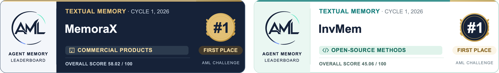
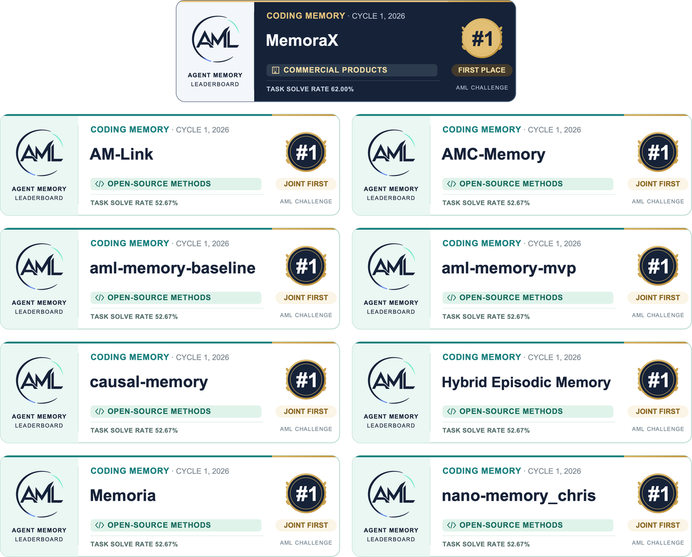

<div align="center">

# 🧠 Agent Memory Leaderboard

**开放、统一、可复现的长期记忆系统评测平台**

[公开榜单](https://agentmemoryleaderboard.ai/leaderboard/industry/textual) | [2026 记忆挑战赛](https://agentmemoryleaderboard.ai/competition/) | [评测状态](https://agentmemoryleaderboard.ai/evaluation) | [平台文档](https://agentmemoryleaderboard.ai/docs) | [接口指南](https://agentmemoryleaderboard.ai/api-guide)

[English](README.md) | **简体中文**

</div>

Agent Memory Leaderboard（AML）是面向智能体长期记忆系统的公开评测平台，提供统一评测协议与公开榜单，评估文本记忆、代码记忆与多模态记忆能力。参评系统提供 **Add**（记忆写入）与 **Search**（记忆检索）接口；AML 平台统一完成回答生成或 Agent 执行、评分、结果复核与榜单发布。平台由来自二十余所高校与研究机构的研究者共同发起，支持开源方法与商业产品在同一赛道、同一评测契约下开展可复核的比较。

## 📰 最新动态

- **2026 年 11 月 4 日 — 第二届正式评测将于 23:59（北京时间）截止。已提交系统须保持 API 可用；平台将按官方安排处理排队任务、进行中的任务及异常重试。**
- **2026 年 10 月 31 日** — 第二届材料提交截止。提交入口实际于 11 月 1 日 02:00（北京时间）关闭，赛事进入评测与复核阶段。
- **2026 年 9 月 20 日** — 第二届 Agent 记忆挑战赛开放报名与评测，设置文本、代码和多模态三个赛道。

## 🏆 第二届 Agent 记忆挑战赛 2026

**第二届 Agent Memory Challenge 由中国图像图形学会（CSIG）主办，南京大学、浙江大学、Datawhale 与 CSIG 企业联络与标准化工作委员会承办**，依托 AML 统一评测平台开展。文本记忆、代码记忆与多模态记忆分别评测和排名，各赛道设置开源方法榜与商业产品榜。

| 赛事节点 | 时间 / 状态 |
| --- | --- |
| 报名与评测开放 | 2026 年 9 月 20 日 00:00 |
| 材料提交截止 | 2026 年 10 月 31 日 23:59；提交入口实际于 11 月 1 日 02:00 关闭 |
| 正式评测截止 | 2026 年 11 月 4 日 23:59 |
| **榜单发布** | **2026 年 11 月中旬** |
| 奖金池 | 人民币 150,000 元；仅面向开源方法榜 |

以上时间均为北京时间（UTC+8）。11 月 4 日正式评测截止后，平台将视实际情况，在随后约两天内尽可能完成排队任务、进行中的任务及异常重试。参赛方须在相关任务结束前保持 API 稳定可用，具体安排以官方通知为准。

[赛事说明](https://agentmemoryleaderboard.ai/competition/) · [查看评测状态](https://agentmemoryleaderboard.ai/evaluation) · [参赛规则](https://agentmemoryleaderboard.ai/rules)

## 🏅 第一届 Agent 记忆挑战赛 2026

首届“记忆之巅·AML 挑战赛”（Agent Memory Challenge，AML Cycle 1）于 2026 年 7 月 29 日启动，首期榜单于同年 8 月 12 日发布。各组别主要结果如下：

- **开源方法组：** [**InvMem**](https://github.com/wenxiaof345-ctrl/vanilla-rag-memory) 位居文本记忆榜首；[**aml-memory-mvp**](https://github.com/0xboyu/aml-memory-mvp)、[**causal-memory**](https://github.com/JingxuanC/causal-memory)、[**Memoria_v2**](https://github.com/lin-guan/aml-rag-v2)、[**nano-memory_chris**](https://github.com/himalalps/nano-memory) 等八个系统在代码记忆榜中并列第一。
- **商业产品组：** [**MemoraX**](https://www.memoraxai.com/) 与 [**MemOS**](https://memos.openmem.net/) 在文本记忆榜和代码记忆榜中均位居前二，领衔首届 AML 榜单。

以下列出开源方法组与商业产品组的前三名次。

### 文本记忆



| 组别 | 🥇 第一名 | 🥈 第二名 | 🥉 第三名 |
| --- | --- | --- | --- |
| 开源方法 | [InvMem](https://github.com/wenxiaof345-ctrl/vanilla-rag-memory)（45.06） | [Refind](https://github.com/imlrz/ReFind)（44.97） | [ActiveMemoryIndex](https://github.com/linxuhao/ActiveMemoryIndex.git)（44.84） |
| 商业产品 | [MemoraX v0.5](https://huggingface.co/spaces/agent-memory-leaderboard/leaderboard/blob/d01a32165aef2124b9732bd0fda7f79380b931dc/data/generated/leaderboard_data.json)（58.02） | [MemOS v2.0.1](https://huggingface.co/spaces/agent-memory-leaderboard/leaderboard/blob/d01a32165aef2124b9732bd0fda7f79380b931dc/data/generated/leaderboard_data.json)（45.89） | [NTES-MEMORY-SMART AML-Eval-SMART](https://huggingface.co/spaces/agent-memory-leaderboard/leaderboard/blob/d01a32165aef2124b9732bd0fda7f79380b931dc/data/generated/leaderboard_data.json)（44.21） |

### 代码记忆



| 组别 | 🥇 第一名 | 🥈 第二名 | 🥉 第三名 |
| --- | --- | --- | --- |
| 开源方法 | [AM-Link](https://github.com/Graygoo7529/AM-L)（52.67%）<br>[AMC-Memory](https://github.com/cxy935/AMC-Memo)（52.67%）<br>[aml-memory-baseline](https://github.com/richrichgo/aml-memory-ba)（52.67%）<br>[aml-memory-mvp](https://github.com/0xboyu/aml-memory-mvp)（52.67%）<br>[causal-memory](https://github.com/JingxuanC/causal-memory)（52.67%）<br>[Hybrid Episodic Memory](https://github.com/tlysanhuo/agent-memory-challenge)（52.67%）<br>[Memoria_v2](https://github.com/lin-guan/aml-rag-v2)（52.67%）<br>[nano-memory_chris](https://github.com/himalalps/nano-memory)（52.67%） | — | — |
| 商业产品 | [MemoraX v0.5](https://huggingface.co/spaces/agent-memory-leaderboard/leaderboard/blob/d01a32165aef2124b9732bd0fda7f79380b931dc/data/generated/code_leaderboard_data.json)（62.00%） | [claude-mem v12.1.1](https://huggingface.co/spaces/agent-memory-leaderboard/leaderboard/blob/d01a32165aef2124b9732bd0fda7f79380b931dc/data/generated/code_leaderboard_data.json)（52.00%）<br>[hs v3](https://huggingface.co/spaces/agent-memory-leaderboard/leaderboard/blob/d01a32165aef2124b9732bd0fda7f79380b931dc/data/generated/code_leaderboard_data.json)（52.00%）<br>[MemOS v2.0.1](https://huggingface.co/spaces/agent-memory-leaderboard/leaderboard/blob/d01a32165aef2124b9732bd0fda7f79380b931dc/data/generated/code_leaderboard_data.json)（52.00%） | — |

## 🎯 为什么需要 AML

长期记忆系统常采用不同的数据集、回答模型、检索参数和评分方法，研究结论与产品成绩因而难以直接横向比较。AML 通过固定数据版本、作答与评分链路、检索限制及聚合规则，在统一评测契约下比较系统表现。

- **覆盖多类场景：** 评估长对话、跨会话交互、代码工程与图文信息中的长期记忆能力。
- **统一比较条件：** 控制影响结果的下游变量，支持同一契约下的可比评测。
- **提供能力诊断：** 同时报告总分、赛道分项与能力维度表现，揭示系统优势和失效模式。

## 🧩 AML 评测什么

第二届评测覆盖以下三个独立赛道。各赛道分别固定数据、执行流程与评分规则。

| 赛道 | 评估内容 | 评测规模 | 评测契约 |
| --- | --- | --- | --- |
| **文本记忆** | 事实召回、多跳关系、时间事件、记忆治理、个性化、规则执行与安全隐私 | 6,000 余个评测实例；32 个数据来源；约 300M tokens | `textual-v1` / `ldbd-textual-official-suite-v1` |
| **代码记忆** | 同一代码仓库中历史工程经验的检索、筛选与复用 | 300 个评测实例；2 类数据类型；约 1.8B tokens | `coding-v1` / `cambench-coding-relevant-noisy-300-v1` |
| **多模态记忆** | 图文记忆的写入、跨模态检索与证据使用 | 近 5,000 个评测实例；7 个数据来源；约 800M tokens | `multimodal-v2` / `ldbd-multimodal-suite-v2` |

## 📚 AML 如何评测

参赛系统提供 **Add**（记忆写入）与 **Search**（记忆检索）接口；平台统一完成回答生成或 Agent 执行、评分、结果复核与榜单发布。正式评测受理后，系统版本、接口配置、评测契约与计分参数固定，确保结果可追溯。

```text
参赛系统 Add / Search → 平台 Answer / Agent → Evaluation / Verifier → 私有结果 → 复核 → 公开榜单
```

### 文本记忆

普通文本任务按 Add → Search → Answer → Evaluation 执行；流式任务按事件顺序持续写入和查询，Add 与 Search 可以交错。Search 默认 `top_k=100`。在 128,000 token 上下文窗口下，扣除 8,192 token 输出空间与 2,048 token 安全余量后，输入预算为 117,760 tokens；超出预算的检索内容按排序从末尾裁剪，原始响应保留归档。

### 代码记忆

一次正式评测包含 150 个基础软件工程任务，每个任务分别在相关历史（`relevant`）与含干扰历史（`noisy`）条件下执行，共 300 个任务—条件评测单元。参赛方提供 Add / Search 接口，平台提供解题 Agent 与验证器。Search 默认 `top_k=100`，上限为 1,000，Agent 可在任务过程中多次检索。

### 多模态记忆

平台按固定配置发送原图与图像描述（caption）。系统可处理原图或使用同一请求中的图像描述，但须支持有序图文内容数组，并如实声明实际处理的媒体类型。Search 可返回文本或图文证据，图片证据由平台传入多模态回答链路。

### 可复现性与结果完整性

- 只有完整且评测契约一致的结果可直接比较；影响得分的变更须升级契约版本。
- 正式样本纳入固定计分分母；错误答案、未解决任务、合法空检索及协议允许的弃答按相应基准规则计分。
- 漏执行、产物缺失、重复样本及数据源缺失均属于执行完整性问题，不得以跳题、缩小分母或补零代替处理。
- 回答模型与解题 Agent 不接收标准答案；标准答案及评分量表仅用于最终评分或验证。
- 禁止样本识别与预制答案、提示词注入、数据泄漏、跨用户检索及外部答案源等规避评测的行为。
- 评测数据与过程产物仅用于本次评测及必要审核，并按规定期限删除。

评测配额、恢复机制与审核要求详见[参赛规则](https://agentmemoryleaderboard.ai/rules)。

## ❓ 常见问题（FAQ）

### 如何接入 AML？

参评方须自行部署 Add / Search API，按[接口指南](https://agentmemoryleaderboard.ai/api-guide)提交固定系统版本、接口配置与所需材料，并按当期规则完成 Smoke 接入验证、Full 正式评测及复核。平台统一完成回答生成或 Agent 执行与评分；申请时间和开放状态以当期[参赛规则](https://agentmemoryleaderboard.ai/rules)为准。

### AML 是否支持多模态记忆评测？

支持。第二届设有独立的多模态记忆赛道，评估图文记忆写入、跨模态检索与证据使用。平台按固定配置提供原图及图像描述（caption），参评系统须如实声明实际处理的媒体类型。详见[第二届赛事说明](https://agentmemoryleaderboard.ai/competition/)与[接口指南](https://agentmemoryleaderboard.ai/api-guide)。

### 不同届次或赛道的成绩能直接比较吗？

只有结果完整且数据、模型、检索限制、计分与聚合规则等评测契约一致时，成绩才可直接比较。两届得分不能仅凭百分比直接比较。文本、代码与多模态也分别排名，不合并为跨赛道总榜。参见[首届代码榜存档](https://huggingface.co/spaces/agent-memory-leaderboard/leaderboard/blob/d01a32165aef2124b9732bd0fda7f79380b931dc/data/generated/code_leaderboard_data.json)与[参赛规则](https://agentmemoryleaderboard.ai/rules)。

### AML 榜单背后包含哪些数据集？

AML 的评测数据由公开基准与平台自建数据集共同组成。文本记忆赛道涵盖 [BEAM](https://github.com/mohammadtavakoli78/BEAM)、[PersonaMem-v2](https://github.com/bowen-upenn/PersonaMem-v2) 等数据集；代码记忆赛道主要采用平台自行构造的评测任务与样本问题；多模态记忆赛道包含 [MemEye](https://github.com/MinghoKwok/MemEye) 等数据集。此外，平台还基于公开语料或现有基准自行构造评测题目，形成不对外公开的私有评测集。这些私有评测集有助于减少针对已知题目的定向优化与过拟合，降低题目和答案泄漏风险，是维护平台评测公平性与结果可信度的重要保障。

## 📁 仓库定位

本仓库发布 AML 的公开评测实现与说明，供社区检查回答与评分行为、复核评测方法并对齐评测口径。

```text
agent-memory-leaderboard/
├── assets/
├── data/
│   ├── beam/
│   ├── clbench/
│   ├── locomo-refined/
│   ├── longmemeval-s/
│   ├── personamem/
│   └── scriptmem/
├── api_config.py
├── requirements.txt
├── README.md
└── README_CN.md
```

为保护评测完整性与参评者隐私，仓库不公开评测数据原文、保留题目、标准答案、评分量表、私有标注、参评系统运行产物、服务凭据及内部基础设施。请勿在 Issue 或 Pull Request 中提交上述材料。

## 🤝 参与贡献

欢迎改进公开文档、澄清评测契约，或提出来源清晰、难度合理、能够补充现有能力覆盖的基准。贡献须保留原始作者署名与许可信息，不得包含私有评测数据、参评者信息、凭据或商业系统内部资料。影响评分的变更应以新契约版本发布。

贡献方式详见[平台文档](https://agentmemoryleaderboard.ai/docs)。

## 📚 引用

如 AML 对您的研究或评测工作有所帮助，欢迎引用：

```bibtex
@misc{agent_memory_leaderboard_2026,
  title        = {Agent Memory Leaderboard: Open and Reproducible Evaluation for Long-Term Memory Systems},
  author       = {{Agent Memory Leaderboard Organizers}},
  year         = {2026},
  howpublished = {\url{https://agentmemoryleaderboard.ai/}}
}
```

## 🔗 链接与联系方式

- 官网：[agentmemoryleaderboard.ai](https://agentmemoryleaderboard.ai/)
- 第一届挑战赛结果：[Hugging Face 榜单存档](https://huggingface.co/spaces/agent-memory-leaderboard/leaderboard)
- 第二届挑战赛：[赛事说明与赛程](https://agentmemoryleaderboard.ai/competition/)
- CSIG 第二届挑战赛官方通知：[Agent Memory Challenge Agent 记忆公开挑战赛即将启动](https://mp.weixin.qq.com/s/y_8a6fcx4bzYvJ5e05qSow)
- 咨询邮箱：[contactus@agentmemoryleaderboard.ai](mailto:contactus@agentmemoryleaderboard.ai)
